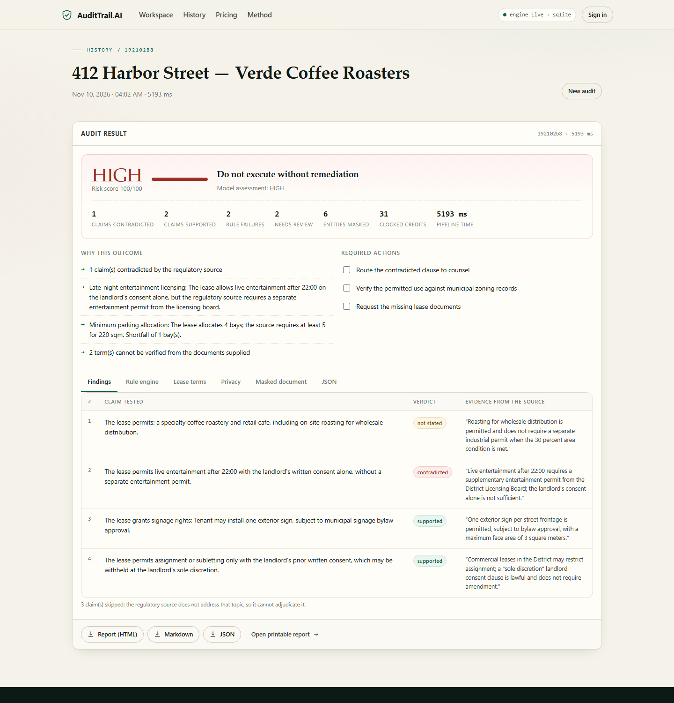

# AuditTrail AI

**Lease compliance with receipts.** Paste a commercial lease and the zoning source it must satisfy. AuditTrail masks every tenant identifier, reads the operative terms, tests each claim against the source, computes the numeric rules itself, and returns a defensible first-pass report with an evidence quote for every finding.

Built for the **[Clocked Build Challenge](https://clocked.rezolve.ai/challenge)** (21 Oct – 10 Nov 2026). Five Clocked endpoints, spanning all three endpoint groups.

[](#tests)
[](#the-five-clocked-calls)
[](#storage-modes)



---

## What it does

A broker, tenant rep or associate receives a 40-page lease and a zoning extract. Today the first pass takes three to six hours of reading and cross-checking. AuditTrail returns that first pass in about five seconds:

1. **Protect** — tenant names, emails, phones and addresses are replaced with stable tokens. Only the masked copy moves forward.
2. **Guard** — the masked document is screened for prompt injection; a dangerous verdict stops the run before any further model call.
3. **Extract** — twelve lease fields are read verbatim with character spans. Missing fields stay null.
4. **Verify** — each operative claim is tested against the regulatory source and returns `supported`, `contradicted` or `not stated`, with an evidence quote and offsets.
5. **Decide** — typed decisions with probabilities set the risk level, the remediation checklist and the human-review flag.

Then the part a model should not do: **deterministic checks**. If the source requires two parking bays per 100 sqm and the lease allocates four bays for 220 sqm, the rule engine computes `ceil(220 ÷ 100 × 2) = 5` and reports a one-bay shortfall — with the clause that requires it. The policy layer can escalate a model verdict on a hard rule failure; it never silently downgrades one.

The output is an exportable report (print-ready HTML/PDF, Markdown, JSON), a persisted audit history, and a one-time re-identification key that AuditTrail never stores.

## Why it is different

| Common failure | What AuditTrail does |
| --- | --- |
| A fluent answer with no source | Every claim carries a verdict plus an evidence quote and character offsets from the supplied source. |
| The model guesses at arithmetic | Numeric rules are computed in code and shown with their formula (`ceil(220 ÷ 100 × 2) = 5`). |
| Tenant PII is pasted into a model | Identifiers are pseudonymised before any later call; the mapping is returned once and never persisted. |
| A poisoned document steers the model | Guard runs before extract/verify/decide; a dangerous verdict fails closed and routes to human review. |
| "Not stated" is treated as compliant | Silence in the source is reported as silence, and surfaced as a documentation gap. |
| A demo that cannot be operated | Accounts, quotas, plans, usage metering, API keys and report exports are all implemented. |

## The five Clocked calls

| Step | Endpoint | Group | The output changes what happens next |
| --- | --- | --- | --- |
| Protect | `POST /clocked/pii` | Protect / Guard / Inspect | Entity spans become stable tokens; every later step sees only the masked text. |
| Guard | `POST /clocked/injection` | Protect / Guard / Inspect | A dangerous verdict aborts the audit before extract, verify and decide. |
| Extract | `POST /clocked/extract` | Decide / Extract / Fill | Twelve verbatim fields (with spans) become the claim list and the numeric facts. |
| Verify | `POST /clocked/grounding` | Verify / Compare / Rerank | Claim verdicts and evidence quotes drive the report and the risk policy. |
| Decide | `POST /clocked/decide` | Decide / Extract / Fill | Calibrated risk, actions and review flag set the banner and the checklist. |

The SDK also exposes `compare`, `fill`, `rerank` and `script`; `docs/ROADMAP.md` describes where those fit.

## Quick start

Requirements: Python 3.11+ (tested on 3.13), a Clocked API key, and optionally a Supabase project.

```powershell
# Windows PowerShell
python -m venv .venv
.\.venv\Scripts\Activate.ps1
pip install -r requirements.txt
Copy-Item .env.example .env      # then paste your keys
python run.py                    # http://127.0.0.1:8000
```

```bash
# macOS / Linux
python -m venv .venv && source .venv/bin/activate
pip install -r requirements.txt
cp .env.example .env             # then paste your keys
python run.py
```

Get a Clocked key at **Settings → API Access** on [clocked.rezolve.ai](https://clocked.rezolve.ai). The challenge code `CLOCKEDHACKATHON` adds 16,000 credits.

The workspace has a **Load sample** button: a synthetic Lusaka CBD lease with a parking shortfall, an entertainment-licensing conflict and two documentation gaps. No sign-up needed — the demo session works out of the box. Sign in (Supabase) to prove tenant isolation.

### Environment

| Variable | Required | Purpose |
| --- | --- | --- |
| `CLOCKED_API_KEY` | yes | Live pipeline. Without it the server fails closed. |
| `CLOCKED_API_URL` | no | Defaults to `https://clocked.rezolve.ai/clocked`. |
| `SUPABASE_URL` | no | Enables Postgres persistence and auth. |
| `SUPABASE_SECRET_KEY` | no | Server-side writes (never sent to the browser). |
| `SUPABASE_PUBLISHABLE_KEY` | no | Browser auth calls. |
| `ALLOW_DEMO_MODE` | no | `true` by default: unauthenticated requests use a demo identity. |
| `STORAGE_BACKEND` | no | `auto` (default), `supabase` or `sqlite`. |
| `STRIPE_SECRET_KEY`, `STRIPE_PRICE_*` | no | Switches billing from sandbox to live Stripe Checkout. |

### Storage modes

Supabase is the production store: `at_profiles`, `at_audits`, `at_api_keys` with row-level security. Run [`supabase/schema.sql`](supabase/schema.sql) once in the SQL editor.

If Supabase is absent or its schema has not been applied, the server falls back to SQLite (`data/audittrail.db`) so the product is always demonstrable. The active backend is shown in the header and at `GET /api/v1/health`. Both backends implement the same interface, and audits are always scoped to the verified identity — never to a `user_id` supplied by the browser.

This build is verified against a live Supabase project: four tables, seven RLS policies, a real audit persisted to `at_audits`, and a second signed-in user seeing zero rows. Evidence: [`docs/SUPABASE_VERIFICATION.md`](docs/SUPABASE_VERIFICATION.md).

## Monetisation

Priced per reviewer, sold to the people who read leases for a living.

| Plan | Price | Included | For |
| --- | --- | --- | --- |
| Review | $0 | 3 audits/month | Trial on a real lease |
| Solo | $49/mo | 100 audits, export, API keys | Brokers and solo counsel |
| Firm | $199/mo | 500 audits, 5 seats, white-label | Boutique diligence teams |
| Enterprise | Custom | Unlimited, on-prem/VPC, SSO | Institutions with data-residency constraints |

Overage is $2.00 per audit. Measured cost: the sample audit consumed **24–32 Clocked credits (≈ $0.007–$0.010)** on the Build plan across runs (1 credit = 25 ms model time, $0.30 per 1,000 credits). That is roughly a 99% gross margin at list price, before payment fees. Full model in [`docs/MONETISATION.md`](docs/MONETISATION.md).

The product implements the monetisation rather than describing it: monthly quotas enforced server-side (`402 quota_exceeded`), plan switching, usage metering, Stripe Checkout when keys are present, and hashed API keys gated to paid plans.

## API

Interactive docs at `/docs`. All routes accept either a Supabase bearer token, an `X-API-Key`, or (in demo mode) no credential.

```
POST /api/v1/audit/process        run the five-step pipeline
GET  /api/v1/audits               audit history for the caller
GET  /api/v1/audits/{id}          full audit record
GET  /api/v1/audits/{id}/report.{html,md,json}
GET  /api/v1/billing/usage        plan, usage, remaining
POST /api/v1/billing/checkout     Stripe Checkout or sandbox notice
GET  /api/v1/api-keys             list keys (paid plans)
POST /api/v1/api-keys             issue a key, shown once
GET  /api/v1/health               engine, storage and pipeline status
```

```bash
curl -X POST http://127.0.0.1:8000/api/v1/audit/process \
  -H "Content-Type: application/json" \
  -H "X-API-Key: at_..." \
  -d '{"document_text":"...","compliance_rules":"...","title":"Harbor Street"}'
```

## Architecture

```
Browser (zero-build PWA)
  ├─ Supabase Auth (email + password) ──► access token
  └─ /api/v1/*  (bearer token or X-API-Key)
        │
        ▼
FastAPI
  ├─ resolve_identity ── verifies token / key hash; ignores client user_id
  ├─ billing.ensure_can_run ── plan quota
  ├─ orchestrator.run_audit
  │     protect → guard → extract → verify → decide   (Clocked SDK)
  │     + pseudonymise (stable tokens, in-memory vault)
  │     + rules.evaluate (deterministic arithmetic)
  │     + policy.assess (escalate, never downgrade)
  └─ storage: Supabase (Postgres + RLS) or SQLite fallback
        │
        ▼
  reports.render_html / render_markdown / render_json
```

Detailed threat model and failure behaviour: [`docs/ARCHITECTURE.md`](docs/ARCHITECTURE.md).

## Tests

```bash
python -m pytest tests -q      # 40 passed
```

Coverage: pseudonymisation (role terms, fragment merging, regex backstops, offsets), fact derivation, claim construction, every deterministic rule, policy escalation and scoring, SQLite isolation, report escaping, API pipeline, quota enforcement, API-key gating and authentication.

Tests use a fake Clocked gateway, so they run offline and never spend credits. Live integration is exercised by `python scripts/smoke.py` (optional; spends credits).

## Deploy

```bash
docker build -t audittrail .
docker run -p 8000:8000 --env-file .env audittrail
```

`render.yaml` is included for a one-click Render deploy (Docker, health check `/api/v1/health`). Any container host works; the app serves both the API and the UI from one process.

## Submission kit

- [`docs/DECISION.md`](docs/DECISION.md) — Streamlit vs FastAPI: the submission decision, with evidence
- [`docs/SUBMISSION.md`](docs/SUBMISSION.md) — Devpost entry copy
- [`docs/DEMO_SCRIPT.md`](docs/DEMO_SCRIPT.md) — three-minute demo, shot by shot
- [`docs/JUDGING_MAP.md`](docs/JUDGING_MAP.md) — rubric → evidence
- [`docs/MONETISATION.md`](docs/MONETISATION.md) — pricing, unit economics, GTM
- [`docs/ARCHITECTURE.md`](docs/ARCHITECTURE.md) — data flow, trust boundaries, failure modes
- [`docs/ROADMAP.md`](docs/ROADMAP.md) — the remaining Clocked endpoints and why they are next

## Security posture

- Raw identifiers never reach Extract, Verify or Decide; only masked text is persisted.
- The re-identification key is returned once to the caller and never written to the database or logs.
- Guard fails closed. Pipeline errors are sanitised: step name and a generic message, never keys or prompts.
- Identity comes from a verified Supabase token or a hashed API key; a client-supplied `user_id` is ignored.
- Supabase RLS isolates rows per `auth.uid()`; the SQLite fallback scopes every query by user id.
- Security headers and a restrictive CSP are set on every response.

## Limitations

The supplied regulatory source is the only authority used for verification. A term the source does not address is reported as *not stated*, which is not a finding of compliance. The rule engine covers the numeric patterns it knows (parking ratios, area caps, permitted hours, signage limits, consent standards); other jurisdictions need their own rule pack. This is decision support, not legal advice.

## Licence and evaluation

This repository is **public for judging and evaluation only**. It is not open source: see [`LICENSE`](LICENSE). You may view and clone it to evaluate the submission, and quote short excerpts with attribution. Commercial use, redistribution or derivative works need written permission.

What is deliberately *not* in this repository — jurisdiction rule packs, evaluation corpora, customer data, tuned prompts — is described in [`docs/IP_PROTECTION.md`](docs/IP_PROTECTION.md), along with the practical plan for protecting the product once it is public.

## Repository layout

```
backend/     FastAPI app, Clocked gateway, pseudonymisation, rules, policy, storage, reports
web/         Zero-build PWA: landing, workspace, history, pricing, billing, method
samples/     Synthetic lease and zoning source used in the demo
supabase/    Schema, grants and RLS policies
tests/       40 offline tests
docs/        Decision record, submission copy, demo script, judging map, monetisation, architecture
run.py       One-command launcher
```

---

Built with the [Clocked API](https://clocked.rezolve.ai/docs) · FastAPI · Supabase · vanilla JS. Proprietary; see [`LICENSE`](LICENSE) and [`SECURITY.md`](SECURITY.md).
